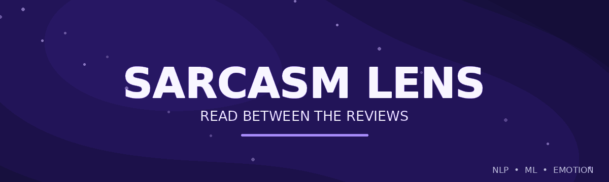

<div align="center">



<br/>


<br/><br/>


</div>

---

## ✦ The idea

**A review can say one thing and mean another.**

“Great, it broke on day one.”  
Is that positive? Definitely not. 🙃

**Sarcasm Lens** is an NLP and machine-learning project that explores how models classify sentiment in text, including reviews containing sarcasm and emojis.

The project uses the IMDb movie-review dataset as a benchmark and a separately annotated custom dataset to investigate how models perform across normal, sarcastic, emoji-only, and mixed reviews.

> The goal isn't just to classify words as positive or negative. It's to explore how well different models interpret the sentiment behind a review.

<div align="center">

| 🎬 IMDb benchmark | 🎭 Sarcasm-aware data | 💬 Emoji-aware features |
|:---:|:---:|:---:|
| 50,000 reviews | 1,168 annotated reviews | 4 review categories |

</div>

## ✨ What makes it interesting?

- **Six model architectures:** compare traditional machine learning with Word2Vec-based approaches and a neural sequence model.
- **Sarcasm-aware experimentation:** evaluate sarcastic and non-sarcastic reviews separately.
- **Emoji and linguistic features:** explore emoji sentiment, punctuation, capitalisation, sarcasm cues, and VADER sentiment contrast.
- **Cross-dataset testing:** train models on IMDb and test their ability to transfer to the custom reviews.
- **Leakage-aware evaluation:** keep near-duplicate review families out of both training and testing at the same time.
- **Local prediction:** run the final saved model without an external inference API.

---

## 🧠 The six models

Six candidates are trained and compared on the custom dataset using the same training and held-out test partition.

| # | Model | What it explores |
|:--:|---|---|
| 01 | **TF-IDF + Logistic Regression** | A strong lexical-frequency baseline |
| 02 | **TF-IDF + Linear SVM** | Maximum-margin text classification |
| 03 | **TF-IDF + Random Forest** | An ensemble of decision trees |
| 04 | **Word2Vec + SVM** | Semantic word embeddings with SVM |
| 05 | **Word2Vec + handcrafted features + Logistic Regression** | Embeddings combined with linguistic and emoji signals |
| 06 | **Word2Vec + BiGRU + Attention** | A sequence model that preserves word order and uses attention |

### 🔍 Feature engineering

The handcrafted feature set contains eight features covering:

- Emoji count and positive/negative emoji signals
- Presence of irony-related emojis
- Exclamation and question mark counts
- Uppercase-letter ratio
- Sarcasm phrase indicators
- VADER sentiment contrast between sentence parts

The feature set is experimental and uses simple heuristics; it is not a complete sarcasm-understanding system.

---

## 🧪 The data behind the experiment

### 1. IMDb movie reviews

- **50,000** labelled movie reviews.
- Balanced positive and negative sentiment classes.
- Used as the conventional sentiment-analysis benchmark.
- A stratified 65:35 train/test split gives 32,500 training reviews and 17,500 test reviews.

### 2. Custom annotated review dataset

- **1,168** reviews.
- Four categories, with 292 reviews in each category.
- Both positive and negative sentiment examples are represented in every category.
- Includes sentiment, sarcasm, emoji, source-group, and split annotations.

| Category | What it contains | Example |
|---|---|---|
| 🟢 Normal | No sarcasm or emoji | `The story was beautifully written.` |
| 🙄 Sarcastic | Sarcasm annotation | `Great, it broke on day one.` |
| 😍 Emoji | Emoji without sarcasm | `Such a lovely film ❤️` |
| 🎭 Mix | Sarcasm and emoji | `Oh great, another delay 🙄` |

**Important:** the sentiment label describes the meaning of the complete review. Sarcasm is a separate annotation, not the sentiment label itself.

---

## 🛡️ Evaluation without data leakage

A perfect score is not always a perfect model.

During early experiments, random row-level splitting produced suspiciously high scores because variations of the same base reviews could appear in both training and testing.

That is **data leakage**: the model may memorise similar examples instead of learning patterns that generalise.

### What changed?

- Reviews are assigned to source groups / near-duplicate families.
- Entire families are kept on one side of the train/test split.
- The notebook checks that no source group overlaps between training and testing.
- The held-out custom test set contains 234 reviews.
- The measured share of test reviews with a near-copy in training (similarity ≥ 0.8) is **0%**.
- Grouped 5-fold cross-validation is used as an additional sanity check.

This makes the evaluation more meaningful, although the custom dataset is still relatively small.

---

## 📊 Results that matter

### IMDb benchmark — 17,500 held-out reviews

| Model | Accuracy | F1-score |
|---|:---:|:---:|
| 🥇 TF-IDF + Logistic Regression | **88.78%** | **0.8893** |
| TF-IDF + Linear SVM | 88.71% | 0.8881 |
| Word2Vec + BiGRU + Attention | 87.90% | 0.8849 |
| TF-IDF + Random Forest | 84.92% | 0.8490 |
| Word2Vec + features + Logistic Regression | 84.46% | 0.8454 |
| Word2Vec + SVM | 84.06% | 0.8416 |

### Custom dataset — 234 held-out reviews

| Model | Accuracy | F1-score |
|---|:---:|:---:|
| 🥇 TF-IDF + Logistic Regression | **86.32%** | **0.8710** |
| TF-IDF + Random Forest | 81.62% | 0.8072 |
| Word2Vec + BiGRU + Attention | 80.77% | 0.8018 |
| TF-IDF + Linear SVM | 76.92% | 0.7805 |
| Word2Vec + features + Logistic Regression | 65.81% | 0.6800 |
| Word2Vec + SVM | 50.85% | 0.6102 |

### Sarcastic vs non-sarcastic performance

The best overall model on the held-out custom test set was **TF-IDF + Logistic Regression**.

| Review group | Accuracy |
|---|:---:|
| Sarcastic (118 reviews) | **88.98%** |
| Non-sarcastic (116 reviews) | **83.62%** |
| Overall (234 reviews) | **86.32%** |

<details>
<summary>📈 Grouped cross-validation results</summary>

The 5-fold grouped cross-validation results for the TF-IDF baselines were:

| Model | Mean accuracy | Standard deviation |
|---|:---:|:---:|
| TF-IDF + Logistic Regression | 73.43% | ±8.71% |
| TF-IDF + Linear SVM | 75.17% | ±5.17% |

The single held-out test result should not be treated as a guaranteed estimate of real-world performance. The cross-validation results show that performance varies across unseen groups.

</details>

<details>
<summary>🌍 Cross-dataset experiment: IMDb-trained models tested on custom reviews</summary>

All six models were trained on IMDb and then evaluated on the custom reviews without retraining on the custom dataset.

| Model | Accuracy |
|---|:---:|
| TF-IDF + Linear SVM | **66.44%** |
| TF-IDF + Logistic Regression | 65.75% |
| Word2Vec + SVM | 65.50% |
| Word2Vec + features + Logistic Regression | 65.50% |
| Word2Vec + BiGRU + Attention | 62.16% |
| TF-IDF + Random Forest | 54.97% |

This is a separate transfer experiment from the custom-dataset model comparison above.

</details>

---

## ⚡ Tech stack · sticker wall

<div align="center">

<em>Tools that power Sarcasm Lens — tap a sticker to explore its documentation.</em>

<br/><br/>

<a href="https://www.python.org/"></a>
<a href="https://jupyter.org/"></a>
<a href="https://numpy.org/"></a>
<a href="https://pandas.pydata.org/"></a>

<br/>

<a href="https://scikit-learn.org/"></a>
<a href="https://www.tensorflow.org/"></a>
<a href="https://keras.io/"></a>
<a href="https://radimrehurek.com/gensim/"></a>

<br/>

<a href="https://www.nltk.org/"></a>
<a href="https://github.com/cjhutto/vaderSentiment"></a>
<a href="https://matplotlib.org/"></a>
<a href="https://seaborn.pydata.org/"></a>

</div>

> ✨ **GitHub README note:** GitHub strips custom JavaScript and most custom CSS from README files. That means true scroll-triggered zoom/fall-in effects and cursor-hover enlargement cannot run reliably inside the README. These linked stickers are GitHub-safe and clickable; the animated header and typing effects remain animated.

---

---

## 🚀 Get started

### 1. Clone this repository

```bash
git clone https://github.com/YOUR-USERNAME/sarcasm-lens.git
cd sarcasm-lens
```

### 2. Install dependencies

```bash
pip install numpy pandas matplotlib seaborn scikit-learn nltk wordcloud openpyxl emoji vaderSentiment gensim tensorflow
```

### 3. Add the datasets

Keep these files in the project directory expected by the notebook:

- `IMDB Dataset.csv`
- `own_dataset.xlsx`

### 4. Launch the notebook

```bash
jupyter notebook IMDB_Sentiment_Analysis.ipynb
```

Run the notebook cells from top to bottom.

> ⏳ Training the IMDb BiGRU model can take several minutes or longer depending on your system and available hardware.

---

## 💬 Try the sentiment predictor

The notebook includes an interactive prediction section.

Enter a review and the final saved **Word2Vec + BiGRU + Attention** model returns:

- Predicted sentiment: Positive or Negative
- Prediction confidence
- A simple sarcasm-cue indicator

Example input:

```text
Great, another movie that wasted two hours of my life 🙄
```

The final predictor uses the saved model `final_word2vec_bigru.keras` and preprocessing bundle `final_word2vec_bigru_bundle.pkl`. Prediction runs locally; no external inference API is used.

**Note:** the final interactive predictor is the BiGRU model. The best overall model in the custom held-out comparison is TF-IDF + Logistic Regression. These are different roles, so they should not be confused.

---

## ⚠️ Limitations & honest notes

- The custom dataset contains 1,168 reviews, which is limited for broad real-world conclusions.
- The initial 768 reviews were generated from 64 base sentences with variations. The dataset was expanded with 400 individually authored reviews, and family-aware splitting is used to reduce leakage.
- Sarcasm depends on context, culture, and tone; simple phrase and emoji cues cannot capture every case.
- Word2Vec is trained on the available project reviews, so its vocabulary may not generalise well to unfamiliar domains.
- Averaging word vectors loses word order and some contextual information.
- The emoji and handcrafted features did not consistently improve model accuracy.
- The custom test set is small, so results should be interpreted cautiously.

---

## 🌱 What this project helped explore

- Text preprocessing and NLP workflows
- TF-IDF and word embeddings
- Traditional ML model comparison
- Feature engineering for text
- Sequence modelling with BiGRU and Attention
- Cross-dataset evaluation
- Data leakage and group-aware validation
- Model saving and local inference

---

## 👩‍💻 Contributors

<div align="center">

| Contributor | Role | GitHub |
|:---|:---|:---|
| **Shibani Mishra** | Contributor | [Add profile](https://github.com/) |
| **Deepakshi Nayak** | Contributor | [Add profile](https://github.com/) |
| **Smruti Ranjan Nayak** | Contributor | [Add profile](https://github.com/) |

</div>

---

<div align="center">

### ✦ Every review has a story. Let's teach machines to read between the lines.


<a href="#top"></a>


</div>
